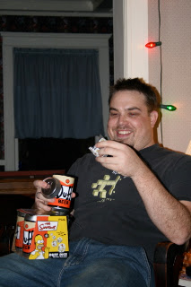

*Originally posted to [headrattle](https://headrattle.blogspot.com/2008/01/brad-birthday-boy.html) on 2008-01-09.*

  
Young Son turned 29 today, at 9:25 AM. Some day I suppose I may need to find another moniker for him, but I guess he'll always be Young Son in comparison to Ole Son, so maybe he's just stuck with that. I found a copy of The Simpsons movie for his birthday, which seemed fitting. We've really enjoyed having him home again this past year and I know there will be a real void when he moves on after DeVry graduation. In the meantime, we enjoy his keen sense of humor, his gentle chiding, and his three-degrees-off-center perspective on the world. We've kind of begun a tradition of board games since his afrrival, rather to my surprise: Rummicubes (Mom), Quidler (Dad), and Guillotine (Brad). Since Christmas, we've also been playing Brad's gift from Zach: Duff Beer. This is becoming one of our favorites, shared with several of our friends as well. Just one of the enrichments brought into our lives by a twenty-something infusion of oafness...
