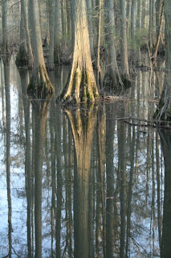
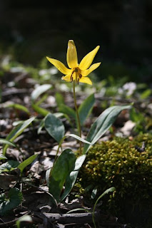
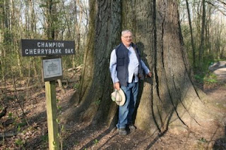
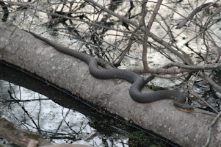

*Originally posted to [headrattle](https://headrattle.blogspot.com/2008/04/brothering-in-illinois.html) on 2008-04-27.*

  
  
  
  
The wind blew, the rain descended, and the earth shook, but the Brother Escapade continued undeterred. In our second annual April outing, Brother John & I followed up last year’s Arkansas exploration with a tour through southern Illinois. It seemed like an odd choice, but friend Bill Crisman recommended the area highly, having grown up near the swamp there. Swamp? Yes! Our whole preconception of Illinois as agricultural flatland underwent a radical shift as we trudged through not only a huge swamp of Louisiana ilk, but also rolling hills and sheer rock cliffs the likes of Arkansas.  
  
The cypress trees in the swamp were most amazing—massive upthrusts jutting out of the dark water, reaching a hundred feet or so to the first limbs, all upheld amazingly by a root system of flying buttresses (an interlacing web of gnarly roots, much of them above water.) We were there one day at sunset and experienced a profound silence, broken only by the calls of Canadian geese and the hammering of woodpeckers against old growth timber. As we left the site we were treated to a rare sighting of a pileated woodpecker, whose extraordinary size accounted for the deep drumming sound we’d heard echoing in the swamp.  
  
Midway through our stay an earthquake measuring 5.2 shook our area. We learned that the epicenter was only about fifteen miles away, but the 4:30 AM tremors awakened neither John nor I from our slumbers, even though it awoke Sharon back home, 250 miles distant, as our house swayed and rattled. It was a far cry from the New Madrid quakes of 1811 and 1812 that leveled entire forests in the area and caused the Mississippi River to flow backward for several days. We probably wouldn’t have slept through that one, although we were both pretty beat from a 20-mile bike ride the day before.  
  
We managed to savor not one, but two, GREAT barecue places: Mac’s in Cairo (thanks for the recommend, Bill!) and The Seventeenth Street Bar in some little town I’ll have to locate again on a map. We also stood beneath the state’s record cherry bark oak tree (GARGANTUAN!), visited Superman’s hometown (Metropolis), saw Fort Massack, and just generally spent five days wandering about seeing what we might see—a lot like our childhood adventures to the woods in days of yore. I think our language needs a new action verb: brothering!
