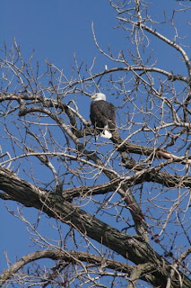

*Originally posted to [headrattle](https://headrattle.blogspot.com/2008/03/eagle-sightings.html) on 2008-03-19.*

  
For forty years since marrying and moving to Independence, MO, I’ve been routinely making the five-hour drive from there to hometown Mt. Pleasant, Iowa.: north up Interstate 35 about halfway, then east on US 34 for the remainder of the five-hour trip. I well know the towns, the hills, and the scenery in all four seasons. But in those scores of drives I saw something this trip I’d never seen before: bald eagles.  
  
The first was perched in a tree near the Ottumwa packing plant along the Des Moines River. I slowed and almost stopped to take a picture, but couldn’t find a safe pull off or turn around. I continued on reluctantly, yet grateful for even the brief one-time sighting.  
  
It’s my habit when making this trip to while away the miles watching along the roadside for hawks--usually, red-tails, which have grown greatly in number through the years. I’d seen at least a dozen in the course of the afternoon, so I wasn’t surprised as I continued along to spot another one in a huge cottonweed tree alongside the road. But wait! That’s no red-tail. That’s another bald eagle!  
  
Almost as though on auto pilot, this time my truck crossed over the highway rumble bars to a stop. The sound of tires on concrete disturbed the eagle, who took flight. So large, so regal! I was feeling good just to have seen one so close when he reeled, and, unexpectedly, landed again in a treetop not quite as near the road but still within clear view. My truck crept forward a couple hundred feet and came to a cautious stop. I opened the door and eased my way out, camera in hand, looking through the view finder. Not bad. I snapped a few shots, then realized there was a tree branch disrupting the composition, so I moved toward the rear and steadied my telephoto against the truck bed, hoping against hope that I wouldn’t spook the quarry. Ok, now, look to the right a little bit…that’s it…hold it…hold it…Snap! That should be a good one, I was thinking as the eagle lifted off once more, this time to disappear over the horizon.  
  
I mention all this because there are some who even yet don’t seem to understand the significance of a species going extinct. Such was the path of the bald eagle until a few decades ago. Today they’re plentiful enough to have their names removed from the endangered list, but only due to the diligence of a lot of very devoted environmentalists and many responsive legislators.  
  
It could be argued that I had driven that highway dozens of times and never seen a bald eagle, so what had I really lost? You don’t miss what you never had, right? The answer to that question came only through an unexpected encounter that in an earlier day would have been routine. To me it was a thrill to see what for the most part has been only a photo in a bird book. There was a connection there that’s hard to describe: something to do with it being the American national bird, I’m sure, but something beyond that as well—the soaring sense of freedom, the grace and beauty, the sense of sharing this planet with so many wondrous creatures.  
  
Yes, I’d driven that road many a time. But until that very day I never knew what I was missing. I’m so grateful we’ve at least begun to preserve the wildness that connects with something deep within.

## Comments

**Jay** — March 21, 2008 at 6:52 AM

Hopefully global warming hasn't shifted the birds range to unsustainable locales.  
  
Hey, how come my glass is half empty?  
  
Sigh,  
  
j

---

**BrotherBemused** — March 30, 2008 at 4:38 PM

Yeah, what's with that cup half full stuff? I could see looking at life that way if it were half full of spit, say, or feces. But come on... don't you by and large find even in the ordinary some rather extraordinary things? I think I'll post something about dung beetles, who roll up cow crap into a ball and use it as a house for their progeny. Now THAT would be a crappy upbringing!

