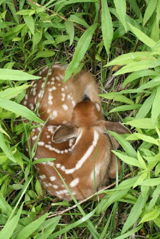

*Originally posted to [headrattle](https://headrattle.blogspot.com/2008/08/fawn-memories.html) on 2008-08-06.*

  
One more step and I’d have literally stumbled upon it. While dutifully cutting brush in the middle of an Iowa field, eyes scanning for the next nuisance weed, I glanced down just in time to stop mid-stride. Curled into a tan-and-white ball, hidden in the knee-high grass, was a lone fawn, lying completely still. The mother would have fled long ago, seeing my approach, but had obviously left strict instructions (or was it simply instinct?) not to move under any circumstances. I too froze, not wanting to harm or startle the young one, then spent fifteen minutes or so just taking it all in—a spotted marvel I felt privileged to have seen. When Sharon arrived on the scene I called her over, then went to the car to get a camera. Through all this the fawn remained frozen without the slightest twitch, other than the occasional blink of an eye lid. In the end we backed off to leave her in peace, and for ourselves felt a deep sense of peace as well.
