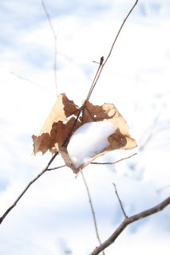

*Originally posted to [headrattle](https://headrattle.blogspot.com/2008/12/first-snow.html) on 2008-12-09.*

  
From my writer's desk at the second story window, I have a bird's eye view of the back yard and the season's first snow. It has come, as it so often does, quietly, blanketing the earth with a hush. The hum of traffic is muffled, the only sound a wind chime stirred by a breeze that also flutters the few remaining leaves that cling to maple and magnolia; the oak and ash are long since bare. The floor of the tree house is covered now in white, and the garden has only a few dark patches where leaves show through. Small drifts have formed on the roof of the garage, and occasional gusts cause it to swirl upward, then fall to the earth below. An occasional squirrel scampers across the yard, and earlier I saw one mourning dove on its usual perch a few feet away, but for the most part the wildlife seems to have taken shelter as if in protest of temperatures that have dipped into the thirties when yesterday they were in the fifties. I mowed the yard then, and had to remove my jacket; today only a few wheel marks show for my labors, and they are fast disappearing.  
  
The blanket of quiet and snow has covered me with serenity. I sense that beneath the often-frantic pace of life there is a season calling me to quiet reflection as a balance to my usual frantic doing. And I'm reminded that the ingredients of peace are very basic: shelter, food, clothing. Today I have all these, plus the warming glow of raspberry tea and the quiet hum of a MacBook Pro. I'm a blessed man.
