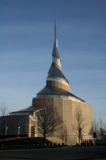

*Originally posted to [headrattle](https://headrattle.blogspot.com/2008/01/foreshadowing.html) on 2008-01-16.*

  
I had an interesting experience yesterday, traveling down Truman Road. As you approach Independence from the west and cross under a stone archway at Blue Ridge, the Community of Christ headquarters looms into view--a distinct "city on a hill" perspective of the Auditorium and Temple, framed in the archway. On this day, however, a fog hung over the horizon and the familiar structures were shrouded from view. It made me think of how my life would be different had it not been for the church. Most of my working life has been linked directly or indirectly to this faith movement. My friends of longest standing are from the church, as are most of my current friends. My theology and world view are shaped by this faith community. I live, almost literally, in the shadow of the Temple. Even in retirement I receive most of my financial support and invest much of my time in congregational or World Church activity. Sometimes I have serious misgivings about the church, resonating with what one writer once penned: "The church is a whore, and I love her." Through the church I received my most serious injury, but also through her I've received my greatest healing. Another of life's paradoxes...

## Comments

**Jay** — January 25, 2008 at 1:20 PM

Huh. I wonder whay **my** greatest injury has been so far. 32 years and counting...

