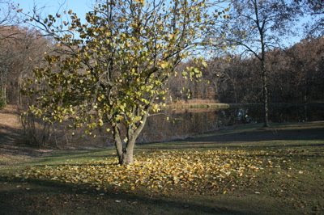

*Originally posted to [headrattle](https://headrattle.blogspot.com/2008/03/great-letting-go.html) on 2008-03-30.*

  
A few months back Sharon & I were camping in Iowa and early one brisk fall morning had the following experience:  
  
A Great Letting Go  
  
There was no wind,  
no motion or sound, that early morning after  
the first killing frost,  
all frozen in place but one--  
a persimmon tree,  
the day before heavy-laden  
with rounded leaves  
of yellow and green,  
hastening now to drop its burden  
before the morning light  
revealed its work undone,  
shuddering imperceptibly  
in a great letting go,  
a flutter and a rustle,  
hinting of great forces unseen,  
laying one last colored shroud  
on a season turning now  
to brown and gray.  
By noon her work was done.  
  
JBHannah 11/7/07
