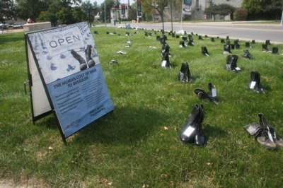

*Originally posted to [headrattle](https://headrattle.blogspot.com/2008/09/guns-or-butter_25.html) on 2008-09-25.*

  
We shared in a United Nations peace vigil last Sunday. A display by the American Friends Service Committee (the Quakers) illustrated the cost in human life exacted by the war in Iraq—142 pairs of combat boots, each one representing a soldier from Missouri or Kansas killed in the war to date. A few pairs of civilian shoes were interspersed with the boots, representative of the hundreds of thousands of Iraqis who have likely died in the war (but whose deaths we don’t tally, being only collateral damage).  
  
And then there’s the financial cost of the war. Pointing out that one day of the Iraqi war costs \$720 million, a series of banners fluttered the message that we could have instead done any of the following:  
• Provided a \$1,700 health insurance policy for 423,529 children  
• Granted 4-year scholarships of \$20,000 to 34,904 state university students  
• Hired 12,478 elementary school teachers at \$57,000 each  
• Provide renewable electricity for 1,274,336 homes at \$565 each  
• Offered Head Start to 95,364 kids ay \$7,550 per kid  
• Built homes for 6,482 families at \$111,000 each  
• Provided free school lunches for 1,153,846 kids at \$624 per year  
• Built 84 new elementary schools at \$8.5 million each  
• Offered healthcare to 163,525 people at \$4,400 per year  
  
In just nine days of Iraq war expenditures we could do ALL of the above. Imagine what could be done with five years of war expenditures! Surely a trillion dollars should have bought us more than it has. (Unless you’re Shell Oil, who this week opened the first Western-owned oil company office in Iraq since 1972, when the nation’s oil supplies were nationalized. Now there’s a great investment!)  
  
Decades ago President Eisenhower lamented that each bomb built is at the expense of needed social services, and in his 1961 farewell address to the nation he sounded a prophetic note of caution, saying "In the councils of government, we must guard against the acquisition of unwarranted influence, whether sought or unsought, by the military industrial complex. The potential for the disastrous rise of misplaced power exists and will persist. We must never let the weight of this combination endanger our liberties or democratic processes. We should take nothing for granted. Only an alert and knowledgeable citizenry can compel the proper meshing of the huge industrial and military machinery of defense with our peaceful methods and goals, so that security and liberty may prosper together."  
  
Evidence that this counsel went unheeded is reflected in the words of Martin Luther King, Jr., speaking six years later about the Vietnam War and the spirit of militarism, saying “A nation that continues year after year to spend more money on military defense than on programs of social uplift is approaching spiritual death.”  
  
Ask not for whom the bell tolls…
