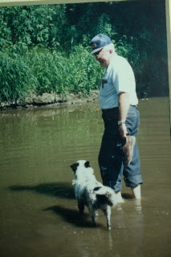

*Originally posted to [headrattle](https://headrattle.blogspot.com/2008/01/intimations-of-mortality.html) on 2008-01-07.*

  
About five years ago a friend and I who attended the University of Iowa Writer's Festival came back home and started a monthly writer's group designed to "foster the writing life." It's been one of the most enjoyable associations of my life, with about six word mavens gathering to write, offer friendly critiques, and revel in the written word.  
  
Tonight I was "in charge," and assigned the topic "Intimations of Mortality (Or Thoughts on Death and Dying)." The result was an amazing group of reflections ranging from childhood near-death encounters to a stump left behind from a dead elm treee. My own thoughts first went my childhood fears of death by lockjaw, then to a near-death encounter in the swimmng pool, then to the fatalistic notion that I would likely never live to age forty because my father, grandfather, and uncle all died quite young.  
  
Finally, though, I was drawn to write about my father-in-law, who was born this day in 1920 and died in 2000:  
  
Whereabouts Unknown  
  
Though he's been gone  
these seven years and more  
at times I turn to him still--  
  
when a butterfly dangles  
from wind-tossed bloom,  
when spider's web glistens  
in morning sun,  
when squirrels' antics  
amaze and amuse.  
  
"Did you see that, Dad?" I say,  
then catch myself  
but wonder still  
DID he see that?  
  
No longer do I hear his ready laugh,  
nor ponder with him life's great mysteries,  
nor see him walk along the pond, cane in hand.  
  
But I like to think I see him there  
somehow  
in the very thing  
that caused me to turn  
and catch my breath,  
and see,  
really see,  
for the first time  
.
