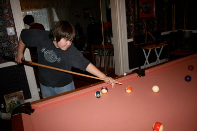

*Originally posted to [headrattle](https://headrattle.blogspot.com/2008/01/just-pooling-around.html) on 2008-01-10.*

  
I was watching TV the other night and saw for the first time an exhibition of speed pool. Now there was pool raised to a whole new level! Each contestant broke the rack, then shot in all fifeen balls as rapidly as possible (which seemed to be typically about a minute and a half.) I had no idea pool could be so athletic, as they raced around the table and positione themselves for the next shot as soon as the cue ball stopped rolling. Since then I've even tried it a few times myself, with my best time being two minutes, fifteen seconds. Our Canadian buddy, Greg, is staying with us for three weeks so he and I have been racking up a few games of nine ball and speed pool each night. It's loosening up my game quite a bit, and added some fun new zest to the old pool table.
