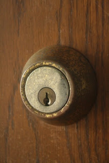

*Originally posted to [headrattle](https://headrattle.blogspot.com/2008/08/lock-in-or-lock-out.html) on 2008-08-06.*

  
Even after 39 years of marriage, and five years of dating preceding it, there remain variances of perception between my beloved and me that crop up unexpectedly, like the stones heaved up by frost each spring in fields that last fall were clear. They're common things, usually, which makes them all the more unexpected when stumbled upon. The latest came to focus as I was locking the back door as I left for a bike ride. "Oh, don't lock me IN," Sharon said. "I'm not," I replied, "I'm locking others OUT."  
  
The incident was amusing on one hand, and disconcerting on the other. My intent was to take what I considered reasonable security precautions as I left, making it less likely that an intruder might enter the home. What I did for Sharon's protection, however, was received as over protection. She chooses in this, and a number of other matters, to live in what she views as trust rather than fear. Well and good. But the rub comes when my natural tendencies toward security conflict with her desires for risk-taking. If I leave the door unlocked, even at her request, I do so with a nagging sense that I'm not being responsible in my care for her. Part of this is probably selfish: I wouldn't want to live with the guilt in the unlikely event that something happened. But part of it is simply an expression of who I am, and the way I convey care or concern.  
  
I'm reminded of a book title that asks, "Do I Have to Give Up Me to Be Loved by You?" The answer, it seems to me, is "Yes, but..." Yes, I choose to change my behavior often in accommodation to the needs and wishes of my companion, as she does for me. Why else be married, if we both just want to live unto ourselves? Our differences are as vital as our likenesses in our marriage covenant, perhaps more so in creating growth. This is just the nature of relationships, which means allowing the other to have effect upon your life. BUT if I give up too much of my self to be in relationship with another, then I'm not really being true to myself, or offering to the other the gift of my uniqueness.  
  
My beloved and I have bumped into this paradox repeatedly throughout the years, so much so that we have posted on our bedroom dresser this passage from Leviticus 19:34-- "The alien who resides with you shall be to you as the citizen among you; you shall love the alien as yourself."
