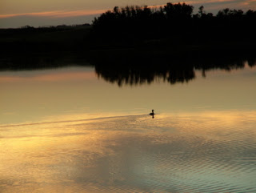

*Originally posted to [headrattle](https://headrattle.blogspot.com/2008/01/man-vs-wild.html) on 2008-01-11.*

  
One of my favorite TV series is Man Versus Wild, where Marine ranger Griz is dropped into the wilderness and makes his way back to civilization. (There's a similar show called Survivorman, but I don't like the protagonist nor the premise nearly as well.) I've seen Griz make his way through swamps, jungles, glaciers, deserts, mountains, and tundra. He's eaten worms, grubs, locusts, raw fish, maggots, spiders, grubs, snakes, rabbits, and pretty much anything protein. He's jumped into quicksand and glacial pools, climbed up palm trees and down avalanches, squeezed drinking water out of elephant dung, used his own urine for a hot water bottle, and started scores of fires with flint and steel. I love it, partly just for the "what will he do next"intrigue and partly for the practical survival tips. I find myself collecting camping gear, and have a great sense of anticipation for the next time I can take to the woods.

## Comments

**Jay** — January 25, 2008 at 1:05 PM

It's beautiful, but I'm not sure your photo matches the exotic danger your post talks about. :)

