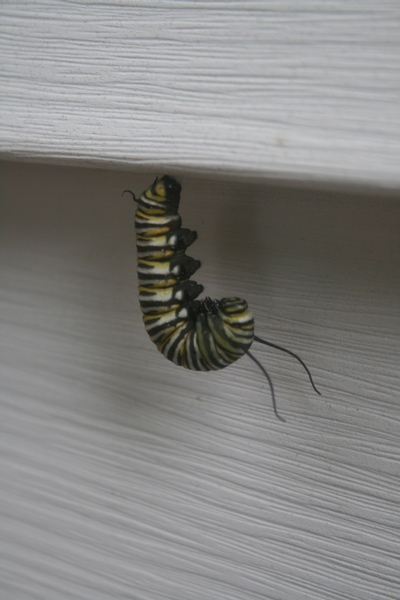
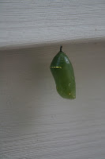

*Originally posted to [headrattle](https://headrattle.blogspot.com/2008/09/monarch-reveries.html) on 2008-09-25.*

  
  
For several years I've been on the lookout for a caterpillar of the monarch butterfly, with no success. I've even allowed milkweeds to grow in our fence row--the host plant around which the monarch life cycle revolves. Still no caterpillars (except for the plastic one my jokester neighbor planted). Then a few weeks ago as I was digging up the day lily bed there it was, the zebra-striped green-white-and-yellow crawler remembered from my childhood, when the Hannah boys grew them by the score. Fantastic! I transplanted it to the milkweed, where it began at once eating voraciously, just as I remembered. Then two days later it disappeared. I thought a bird must have eaten it, since usually they form their cocoon right on the milkweed. Bummer. Then a day or so later I happened to glance to the side as I was going up the back steps and there he was, our caterpillar, suspended upside-down, curled up in the beginning of a new life stage. Within two days the familiar gold-rimmed pale-green cocoon formed, and in my daily comings and goings I watched for signs of hatching out, only to come home one evening to find that my friend had taken flight. I didn't get to see him on the wing, but my imagination soared as I thought of his long journey to winter in Mexico. All of which has brought me to a new item on my Bucket List, joining the migration to see the wintering site firsthand. I've seen small monarch clusters in Iowa and in Michigan; how amazing it would be to see entire mountainsides robed in flutters of orange and black!

## Comments

**Jay** — October 15, 2008 at 8:52 AM

Ooo! Ooo! Can I go? :)

