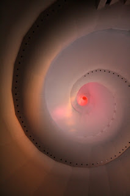

*Originally posted to [headrattle](https://headrattle.blogspot.com/2008/01/musings-on-muse.html) on 2008-01-08.*

  
I was really energized today in seeing twelve of my photos enlarged to banner size and placed on display in the Temple. For the next three months, as renovations are underway in the Temple sanctuary, visitors will have a "virtual tour" of the interior through photos, a brochure, and a large-screen DVD presentation. Afterwards the display will go on the road, allowing folks who will probably never be able to see the Temple in person to at least get a glimpse. How cool, to think that my photos may travel to Africa, or Asia, or South America...  
  
From this experience I've been made reminded that one of life's greatest blessings is creative expression. I feel it in obvious things like photography, or writing, or music, or preaching. But there are many other occasions as well: building a tree house, placing a Geocache, hosting a small group, building a Habitat home, etc. It has to do with creating something that has never been before, or would never had been without what you bring to it in the way of interest, ability, energy, etc. To me it's one of life's greatest joys, most uniquely revealing of what is truly "me," but at the same time expressive of something much greater.
