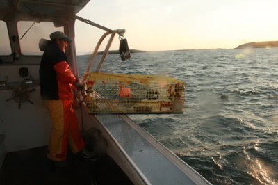

*Originally posted to [headrattle](https://headrattle.blogspot.com/2008/10/noahs-ark.html) on 2008-10-24.*

  
Buzz Carver has been on the ocean since childhood, and has spent the last twenty years as a full-time lobsterman off the coast of central Maine. Last Tuesday night he took four of us Midwesterners out to sea so we could get some sense of the vocation that claims him and his father before him. He only ran a dozen or so lobster traps for our benefit, rather than the 250 he might haul in a routine work day. But it was enough to get a pretty good sense of what he does all day long, year-round.  
  
It’s a pretty basic routine: boat out to any one of his more than 700 lobster traps, marked by a bright pink-over-yellow buoy. Snag the rope with a hooked gaff, lashing it to a hydraulic winch to bring it alongside. Haul the metal trap aboard and remove the lobsters inside (measuring each one carefully, tossing back males that are too small and females designated for breeding). Empty the mesh bag that holds the old bait and replace it with new salted herring. Then throw the trap back overboard and head for the next one.  
  
It used to be they stopped lobstering in the winter, but now the catch goes on year-round. The difference in the colder months is that Buzz travels to more distant sites, up to thirty miles from his bayside home. It’s hard and sometimes dangerous work, but as his boat cuts through the water, throwing plumes of foam from the prow, as he pulls alongside a rocky isle to point out a family of seals, as the seagulls circle overhead and the sun begins to set in crimson colors…Well, this is obviously a man who has found an enviable merger of vocation and avocation.  
  
Never mind that the price paid by Canadian-controlled processing plants plummeted this week from \$4 a pound to \$2, that acts of trap vandalism and pilfering are on the increase, that it costs \$100 to purchase each trap and the accompanying gear, that state and federal fishing regulations are often inconsistent and inept.  
  
Buzz is a Maine lobsterman, and hopes to always be. And his son, Noah? Suffice to say that when Buzz was finally able to buy his first new boat a year ago he didn’t name it for his wife Suzanne, as customary. Instead, painted on the stern is a scripture passage from Genesis, and in larger letters the name of his craft: Noah’s Ark.
