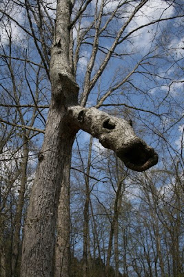

*Originally posted to [headrattle](https://headrattle.blogspot.com/2008/04/overlooked.html) on 2008-04-27.*

  
How very much of my life I have rushed through, unobservant and unaware! I was hiking a few weeks ago, stopped to catch my breath, and in doing so found myself in the friendly watch care of a gnarly tree limb that for all the world looked like a mythical sea urchin, or dragon, or something of that ilk. How long had it been there, watching hikers come and go? Had anyone ever seen it there? Will anyone ever see it again? I felt oddly chosen by a strange confluence of events: having misplaced my camera, rushed back to the truck to get it, then traversed a second time the trail on which I had earlier bypassed this forest sentry. Had I not become winded on my second traverse, had I not happened to glance back the way I came, had the lighting been even slightly different, odds are I would have missed the whimsy altogether. I’m grateful…and, hopefully, more aware of the need to be more aware. It’s as the poet says, “The world lacks not wonders, but wonder.” I wonder how much I’ve already missed in the daily rush of life?
