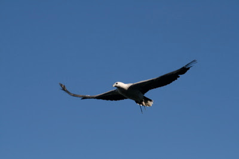

*Originally posted to [headrattle](https://headrattle.blogspot.com/2008/01/planet-earth.html) on 2008-01-02.*

  
  
For Christmas Sharon gave me the five-CD PBS series, "Planet Earth" and last night I watched the first sequences: from pole to pole, mountains, and fresh water. Absolutely stunning. The dust cover urges "prepare to be overwhelmed by the beauty and majesty of Planet Earth," which is altogether as appropriate a caution as the warning label on cigarettes. I'm addicted, AND overwhelmed.  
  
The photography is so exquisite and the scenes so memorable it takes me back to childhood days and the wonder of watching a monarch twitch to freedom from its pale green cocoon, or a dung beetle out for a stroll with its eggs safely ensconced in a ball of cow manure, or an ant lion lying in wait at the bottom of its conical trap for a hapless ant to drop in for supper, or a water skipper effortlessly zipping across the surface of the water on spindly legs. Incredible! That sense of wonder and mystery stirred again through Planet Earth, where a combination of the latest technology and the most inaccessible locations offered never-before-seen views of the wonders of our planet: a massive great white shark leaping clear of the water for a seal tidbit, birds of paradise strutting their stuff in dazzling displays of color and movement, a snow leopard catapulting off jagged mountain crags in pursuit of prey, piranhas stripping their victims to the bone in seconds, massive herds of caribou, water buffalo, birds, and elephants making their annual migrations,  
  
Scene after scene of jaw-dropping action and beauty create what for me is a religious experience, blending creation and Creator in the stirring of awe and gratitude. (CAUTION: PREACHING AHEAD!) Even without that association I think nearly any viewer would sense something of the "miraculous" web of life on Planet Earth which we humans are blessed to share. The "Oh my God!" moments of this series will hopefully move millions toward preserving our natural heritage. It's disturbing to consider how very far away from human disturbance many of these scenes had to be filmed, and even more so that these may be the last glimpses of many life forms our species destroys through pollution, poaching, and destruction of habitat. I'm so grateful to have seen them, even if only second hand, and hope to experience in more direct manner much of what remains. Such a marvel!
