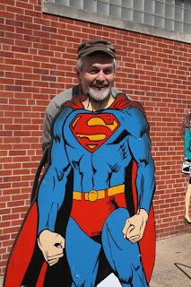

*Originally posted to [headrattle](https://headrattle.blogspot.com/2008/04/poem-to-virgins-to-make-much-of-time-by.html) on 2008-04-27.*

  
Poem: "To The Virgins, To Make Much Of Time" by Robert Herrick. Public domain.  
  
To The Virgins, To Make Much Of Time  
  
Gather ye Rose-buds while ye may,  
Old Time is still a flying:  
And this same flower that smiles today,  
Tomorrow will be dying.  
  
The glorious Lamp of Heaven, the Sun,  
The higher he's a getting;  
The sooner will his Race be run,  
And nearer he's to Setting.  
  
That Age is best, which is the first,  
When Youth and Blood are warmer;  
But being spent, the worse, and worst  
Times, still succeed the former.  
  
Then be not coy, but use your time;  
And while ye may, goe marry:  
For having lost but once your prime,  
You may for ever tarry.
