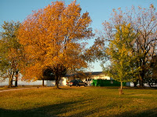

*Originally posted to [headrattle](https://headrattle.blogspot.com/2008/01/presidential-hope-fullers.html) on 2008-01-03.*

  
A news report last night said that the presidential candidates have spent more than \$100 million on the Iowa caucus--about \$400 each for the number of anticipated caucus-goers. It almost makes me wish I'd never left my home and native state, since I'll miss out on cashing in. I think I'll propose to the candidates that there be legislation passed similar to the sovereign nations accord recently enacted by the United Nations, essentially acknowledging that "once and Iowan, always an Iowan." Iowa is, after all, a Native American word. And heck, I don't want an entire reservation or anything as posh as all that, just some modest dues that they were going to give anyway. In the same note I'll suggest that they just send me my \$400 direct and save the endangered airwaves, which I can only assumed have been more jammed with political ads than a salmon stream at spawning time. Why not? Shucks, then they wouldn't have to endure the broiling heat and the freezing temperatures I've heard them complain about in this frantic year as the Fly Over Zone has become a Destination for candidates and their retinues. Such a sensible solution would surely be embraced by candidates and Iowans alike, to everyone mutual satisfaction. Even if my proposal fails, I sure hope Mom and Dad at least get their due for having remained loyal through the years to the state where the tall corn grows, despite election years that bring hordes of politicos in tornadoes of hot air.

## Comments

**Jay** — January 5, 2008 at 10:30 AM

That strategy sure worked when I was at Iowa State. I can't remember what politician it was that bought us a live band, 12 kegs, and the \$40 tickets you "need" to get into the caucus, but you bet your sweet bippy that's the guy we voted for.

---

**BrotherBemused** — January 5, 2008 at 10:31 PM

Yeah. Would to God we had used the same strategy in Iraq. Let's see, one trillion dollars divided among 25 million people. What's that figure out to be? I think that's 40 million apiece. I'd have to think that if we gifted hem with anywhere near that amount we'd have long since "won the hearts and minds of the Iraqui people!"

