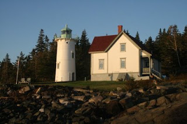

*Originally posted to [headrattle](https://headrattle.blogspot.com/2008/10/restless-tide.html) on 2008-10-24.*

  
Through the years I’ve often read poems and sung songs about the ocean’s “restless tide,” but until we stayed overnight at Maine’s Little River Lighthouse its meaning never really connected. That reality began to soak in as our little boat ferried us to the island at high tide, our guides explaining that the dock would be high and dry during low tide. We were told that the water level here varies as much as 28 feet between the tides, and this twice a day!  
  
From the moment we set foot in the boat until we disembarked a day later we were surrounded by the ocean’s ebb and flow, an incessant surround sound somehow both soothing and unsettling—soothing in its rhythmic regularity, unsettling in its chaotic churning.  
  
For an Iowa farm boy like me the constant spew of foam and spray had no parallel; even the wind was more buffet than breeze. I began to think about how different must be the life outlook of an Iowa farmer and a Maine fisherman. What would it be like to cast your net upon the restless sea rather than plow straight furrows in terra firma? How would it differ to rely on a daily catch rather than a single autumn harvest? And does it take more courage to gamble daily on the vagaries of the ocean, or to risk it all on one big jackpot?  
  
I’m thinking that for hardiness and courage the edge likely goes to the Mainian, although for sweat and grit the Iowa farmer comes right alongside. Either of them, in comparison to a city-dweller, is to be envied for a living connection with land or sea, and the courage to embrace a love that both gives and takes away.
