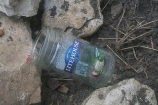

*Originally posted to [headrattle](https://headrattle.blogspot.com/2008/08/seeing-through-glass-darkly.html) on 2008-08-06.*

  
How are we ever going to really “go green” here in the US without an integrated approach to conservation and the environment? A case in point: last year it was possible in Independence to recycle glass containers, either by paying the trash hauler or by taking it to a recycling center. Today you can do neither. Why? The official explanation is that is no longer “economically viable” to recycle glass, since its major ingredient—sand—is so readily and inexpensively available.  
  
I think of that explanation with distress every time I now throw away glass after several decades of trying faithfully to “reduce, re-use, and recycle.” It seems so obviously short-sighted to consider only the cost of glass manufacture when determining “economic viability.” What about the cost of hauling the stuff to a landfill, maintaining the landfill, and creating new landfills? Oh, that.  
  
Well, if you throw in all THAT expense just maybe it might be a viable option. But industry doesn’t look much beyond the bottom dollar for their investors, and government doesn’t look much beyond re-election by the taxpayers, and neither looks much beyond the press of immediate issues, so who cares all that much about a few tons of glass bottles?  
  
Years from now, when people are mining our landfills to reclaim the treasured resources we’ve squandered, what will they think of us? Surely seeing all our discards, not the least of which will be glass, they’ll view us as fools and wastrels.

## Comments

**Jay** — August 7, 2008 at 9:06 PM

Whoah, spooky. [A Scanner Darkly](http://www.imdb.com/title/tt0405296/) is my next Netflix movie.  
  
Listening to an NPR podcast this morning I heard a gentlemen who spent \$70K on a Cadillac Escalade last year is now trying to sell it, and can only get \$35K. But he "has to sell it because gas prices are killing him." Which makes no sense, since the \$1 per gallon rise in gas will only cost him about \$1K per year. Yet he's desperate to take a \$35K loss trading in the vehicle.  
  
The point the NPR interviewer and guest author were making is that we're emotional creatures that often do not make rational decisions, especially about money. I suspect conservation falls into the same vein.

---

**BrotherBemused** — August 10, 2008 at 10:06 PM

We have a long-time friend who scoffs at our recycling efforts, saying we spend more energy driving it to the drop site than we conserve by recycling. Of course, he also swears by nearly everything Rush Limbaugh says, so I just ignore him. Recycling makes me feel good! : )

---

**Jay** — August 11, 2008 at 10:05 AM

Ya. Among my current set of grossly uninformed opinions are: (1) we do have a global warming problem, (2) recycling is good even if for no other reason than it makes people think along green vs. consumption lines, (3) ethanol is massively over-rated and should not be propped up with my tax dollars.  
  
Oh. And I hate politicians. :(

---

**BrotherBemused** — September 22, 2008 at 7:55 AM

Well, your head may not be screwed on just right, but at least it's screwed on at a similar angle to mine...I agree with you in declarations one through three, and am trying to "love my enemies" in connection to politicians, who in the long term seem much more alike than distinctive. Even my Obama hopeful, who pledged a new type of campaign rather than the politics-as-usual slash and burn variety brings out the heavy artillery and fires back once the hounds of political war have been unleashed. Winning seems to be the ultimate end of politicos, means be damned.

---

**Jay** — September 23, 2008 at 7:45 AM

Well, don't give up on Obama yet. (I've given up on all politicians, not Obama specifically.) It's possible he's playing the game the only way it can be won. FAR more important, what he actually does in the white house.  
  
I think I hate politics, and only hate politicians by extension. Reducing everything to a soundbite undermines all the serious issues we should be facing.  
  
I hope Obama doesn't waste 90% of his energy getting elected/re-elected and looking good, instead of working. Unfortunately the system we have puts people with that set of priorities in office time and time again.  
  
Tony Blair observed that British elections last four weeks, while ours last four years. What a waste.

