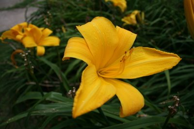

*Originally posted to [headrattle](https://headrattle.blogspot.com/2008/09/some-five-years-ago-my-friend-sam-rose.html) on 2008-09-25.*

  
Some five years ago my friend Sam Rose gave me 150 or so day lilies; recently I dug them up to give them some growing space. How incredible the increase! I still had my 150 plants, but also mailed a boxful to Sam in Arizona and to Brother John in Nebraska, plus gave a wheelbarrow full to friends Bud and Mark. Mother Nature, thou art one prolific lady!
