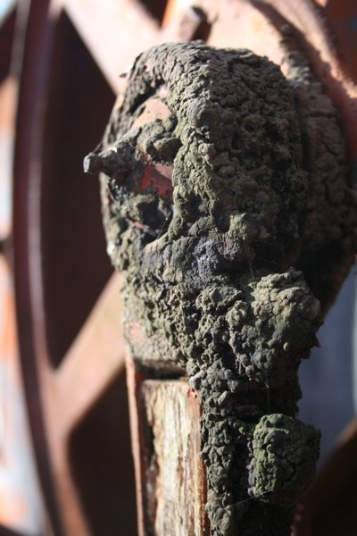

*Originally posted to [headrattle](https://headrattle.blogspot.com/2008/03/virtual-reality-or-pseudo.html) on 2008-03-01.*

  
"Virtual reality." The term has been around long enough to have made the dictionary: "the generation by computer software of an image or environment that appears real to the senses." (The Oxford Dictionary)  
  
I'm increasingly grateful that my own childhood years pre-dated virtual reality. Instead, I had what, at the risk of redundancy but for the sake of emphasis, might be called "actual reality." The images and environments I have in my memory are not just the appearance of reality, but reality itself--watching a cocoon twitch violently and finally break open to reveal a shrink-wrapped butterfly that oh so slowly unfolded; biting into a sun-warmed tomato, red juice gooshing down neck and stomach; climbing a young sapling to the very top, then riding it backwards to the ground; hearing the shrill call of cicadas, mingled with the low barumph of bullfrogs in a rhythmic symphony; being battered by the wind in early spring, numb fingers sending home-made box kites aloft until they nearly disappeared from sight.  
  
The wonder of these moments is so real to me even decades later that I can still see and taste and smell and hear and feel their touch as though they were here-and-now. So when Louis Armstrong sings "What A Wonderful World" I find myself without fail singing along with him the closing exclamation,"Oh, yeah!"  
  
It deeply saddens me that so many of "the computer generation" seem to prefer virtual reality over reality itself, which I can only liken to keeping the wrapper and throwing away the chocolate bar. How could any computer role-playing game compare to the suspense of night-time hide-and-seek, or playing "soldiers" with home-made weapons, or charging each other full-tilt as knights armed with horseweed stalks? How could even the best nature documentary compare to actually experiencing the Northern Lights, or the Milky Way? How could even theatre surround sound capture the marvel of a click beetle arching its back, then snapping itself into the air for a perfect acrobatic flip?  
  
I could go on and on, but I suppose it would be futile. Reality is like a good joke: sometimes you just don't get it unless you were there.
