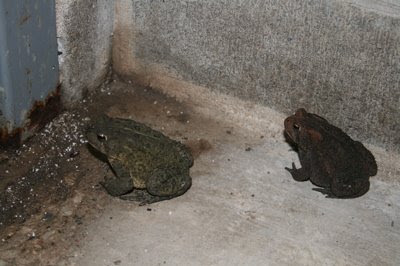

*Originally posted to [headrattle](https://headrattle.blogspot.com/2008/08/warts-and-all.html) on 2008-08-06.*

  
Our bath house at Morris Park has two seemingly permanent occupants. Nearly every time I open the door and turn on the light I’ve learned to look in the corner for Tom and Tess—a pair of toads who seem to find the dark and the damp, crawling with insects, an ideal home.  
  
The names were Sharon’s doing. Although I’ve long respected toads for their role in gobbling up insects harmful to the garden, I’ve never before been on a first-name basis.  
  
Observing them, it’s difficult for me to see the infatuation children’s writers seem to have for these lumpy creatures. They seem to do very little other than sit around waiting for lunch to crawl by, and if you pick them up they pee on you. Hardly adorable traits. Nor do they seem particularly wise as sometimes depicted in children’s books; this particular pair seems barely able to keep from being squished in the door as it opens and closes.  
  
Maybe I just haven’t had a sufficiently long-term association out of which new perceptions might arise. Karen Stark, who came over for campfire foil meal tonight, says she once had a toad that seemed to enjoy being petted—even turning over on its back to be stroked on the stomach! They’re not like frogs at all, she hastened to assure us.  
  
So I guess tomorrow I’ll quit with the tip-toe, hands-off approach and see if I can form a more lasting relationship. Maybe I can at least quash the persistent urban legend that humans give you warts.  
  
Postscript: This morning only Tess remained in the bath house, squatting in the center of the shower drain. Tom apparently was off hunting and gathering, as all good males are wont to do. By afternoon, Tess had also departed, which I take to mean that my twice-daily intrusions may have led them to choose a less-frequented neighborhood. Ah, the challenges of inter-species dialogue!
