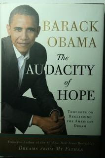

*Originally posted to [headrattle](https://headrattle.blogspot.com/2008/01/we-are-ready-to-believe-again-barack.html) on 2008-01-04.*

"We are ready to believe again," Barack Obama said last night in conclusion of his victory speech at the Iowa caucus. It was a rather resounding and unexpected 8-point showing over rivals Clinton and Edwards, perhaps signaling that the nation is indeed ready, as the young Illinois senator said, to move from war to peace, from despair to hope, from division to unity. I want to believe it myself, even knowing that Obama now goes to the New Hampshire primary as an underdog, and aware that now he will really be set upon by the the attack dogs. (I saw this morning an internet allegation that Obama is a secret Black Muslim.)  
  
I'm relieved that both the Democratic and Republican front runners seem in marked contrast to the leadership of the last seven years, most importantly for seeming to have actually listened to what the American public has been saying about the Iraqi war, health care, the economy, etc. Bush has shown such a determined lack of curiosity and concern about what his constituency thinks or feels that it's refreshing to think that our top representative might actually make some effort to represent us. Neither candidate seems as ideological, inflexible, clueless, arrogant, and humorless as George W. Bush, so I am indeed "ready to believe again," even while anticipating the inevitable gap between politico rhetoric and politico action.  
  
Who knows? Maybe for the first time in decades I'll actually be able to vote for someone I'm enthused about, rather than against someone I'm concerned about. Ever the optimist, evidence to the contrary. I believe, brother.

## Comments

**Jay** — January 5, 2008 at 10:37 AM

Good on ya. I'm so jaded nowadays that thinking or talking about candidates makes me angry. Yesterday I went half-ballistic in IM with my boss, cursing out the politicians.  
  
Obama is an excellent public speaker. But I've trusted politicians before and don't want to get hurt again. Anger in my defense mechanism.  
  
Those bastards. \>:-(

