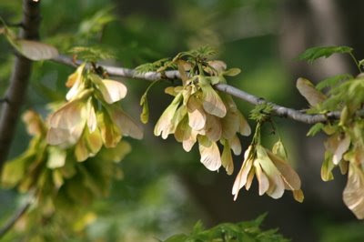

*Originally posted to [headrattle](https://headrattle.blogspot.com/2008/05/whirligigs.html) on 2008-05-11.*

  
The second-story window in front of my writer's table looks out at a silver maple that has been putting on quite a show. In recent weeks thousands of whirligigs have formed, grown, and turned turned from green to brown. Now they are ready to try their helicopter wings. Though calm prevails in the late afternoon as I write, the wind has been up the past few days and with each gust a fleet of earth-bound kamikazes has been launched. Some of them, in brief defiance of destiny, have caught an updraft and captured my attention for their odds-defying ascent. By contrast, some never catch the wind but fall straight down in a graceless headlong plunge. But the majority describe a rhythmic circular glide pattern as they wend their way earthward. It's an amazing sight, with the ground below, and for yards around, covered with seedlings. From the ranks of thousands, some few will take root and themselves parent seedlings in turn as the cycle of life repeats once more. Since it's all about propagation, I guess you could say the whole event is sexy, just like spring.
