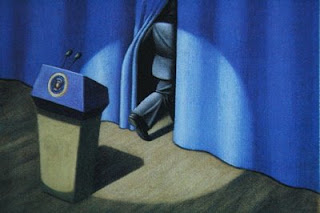

*Originally posted to [headrattle](https://headrattle.blogspot.com/2009/02/bushed-no-longer.html) on 2009-02-05.*

  
I'm ever so slowly adjusting to the change in presidential leadership. For eight years I've felt our nation has been hijacked by an alien ideology that has undone much of the gains of recent decades. When the American public re-elected Bush for a second term I first felt disbelief, followed by a prolonged period of grief. Now I'm beginning to warm to a sense of hope, ever so slowly.  
  
I couldn't quite describe my feelings until I read the account of Garrison Keillor, who attended President Obama's inauguration. He described the crowd's "profound silence" when Bush's presence was announced, and the "low and heartfelt rumble of booing" when Cheney appeared. All this contrasted sharply with the jubilant roar of the crowd when the Obamas appeared. There was, however, a later roar for the Current Occupant:  
  
"When the chopper lifted up above the Capitol and we saw it in the sky heading for the airport, a million jubilant people waved and hollered for all they were worth. It was the most spontaneous, universal moment of the day. It was like watching the ice go out on the river."  
  
That's the perfect metaphor to describe how I'm feeling these days: like the ice going out on the river.
