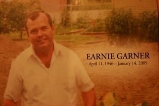

*Originally posted to [headrattle](https://headrattle.blogspot.com/2009/02/endnotes-for-earnie.html) on 2009-02-05.*

After the memorial celebration, Earnie, we returned home and gathered (where else?) around the island in your family kitchen—the centrifugal center of comfort and warmth. I’d been thinking about your railroading hobby, which was illustrated during the service and was so evident in the living room nearby—train sets, time tables, photos, and the like.  
  
“I’ve been wondering,” I asked, “whether Earnie would have been a railroad engineer, or a conductor?” I explained my idea of the engineer as the driving force—he fires the engines, throttles up, and lets ‘er rip. I think of the conductor, on the other hand, as the overseer—he punches out details, worries that the train runs on time, makes sure folks get where they want to go. I hardly got the question out before your wife and your eldest child both replied, nearly in unison, “Both!” We all laughed, and sensed that you would have laughed right along with us. So much to do, so little time.  
  
I don’t know just what will happen to your To Do notebooks now, Earnie. I imagine they will be cherished mementoes of your vision and passion. After these several days with your dearest friends and family I’d been thinking a lot about the guiding traits of your life and have arrived at two that seemed most evident in the stories told by friends and family. One is “irrepressible enthusiasm”—a child-like zest for life, for living large. The other is “forever possibilitizing”—the visionary quality of Don Quixote as he sallied forth on both adventure and misadventure, always dreaming the impossible dream. I can only think that even now you are “about your Father’s business” in that same spirit.  
  
Whatever happens to your To Do lists, I’m assured of one thing. Having been welcomed into the homes and lives of your beloved wife and children, there’s no doubt that you’ve passed along the Earnie DNA of humor, drive, and compassion that will live on through them. Coupled with the singular Marilyn DNA, your children, grandchildren, and all who follow in your line will surely lead lives both exceptional and contributive. I see each of you in each of them, and I know the circle of life continues.  
  
What I don’t know is why your life ended so soon. Wouldn’t it have been better for all if you’d seen your grandkids grow up, if you’d taken more trips with Marilyn, if you’d been around longer for Susanna, and John, and David? As I said at your memorial, death is an inscrutable Mystery. But I trust you now know more about all this than I do. And I trust, as you did, in Love as the eternal reality undergirding even that which we cannot see.  
  
I regret we didn’t spend more time together in these years since college. I’m going to check out that “Bucket List” movie and watch it again, because there’s something Earnie-like in there about friendship and life and death I need to hear again—something about living life to the full, whether it be a single day or many years. In this and many other ways I’ll remember you, and will be looking to the time spoken of in Genesis, when in Zion we shall again embrace and rejoice together, in that blessed union of souls. (Kind of a “Graceland Forever” sort of thing.)  
  
I look forward to our adventuring once again, in God’s due time. Meanwhile, I am comforted by the thought of Robert Browning, who wrote, “Ah, a man’s reach should exceed his grasp, or what’s a heaven for?”  
  
I’d tell you to “Rest In Peace” but somehow that just doesn’t fit. So instead I’ll just say what you might tell a railroad conductor/engineer: “Ever Onward!”
