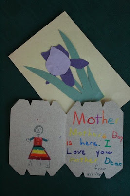

*Originally posted to [headrattle](https://headrattle.blogspot.com/2009/01/mother-dear.html) on 2009-01-28.*

  
It was the sort of thing real Moms just do, so subtle it’s taken me several days to really catch on. While her four sons were home last weekend, in her 85th year, Mom quietly bequeathed to us each a piece of our heritage, a part of her legacy.  
  
I first noticed mine lying on the piano bench: a stack of artwork I created as a child. They were mostly things I would have brought home from school—art projects large and small, some crude in earlier years, some more refined later on. A bit yellowed and brittle, they were long-forgotten, yet strangely familiar, like hearing a snatch of a song from long ago that you can’t quite put a name to but later find yourself humming over and over.  
  
Leafing through the stack, I could easily imagine why Mom might have saved some of them all these years. Several were Mother’s Day cards, like the one with a bouquet of colorful tulips on the cover and a message inside written in my best nine-year-old longhand: “You are the best mother in all the world. Love, Jim.” The card from the previous year showed that as an eight-year-old I was still writing in block letters, but with a beginning sense of rhyme and verse: “Mother’s Day is here. I love you Mother Dear.” Apparently I made not just one, but two, cards that year, the other reading “I love you Mother Dear. I hope you don’t shed a tear.” I read those words with a jolt of recognition. In recent years, intentionally but for no conscious reason, I have begun calling Mom “Mother Dear.” To read that same term of endearment in my own handwriting from more than fifty years ago gave me a keen sense of déjà vu and a renewed connection to the child I once was.  
  
The earliest of Jimmy’s Mother’s Day collection was when I was six years old: a tissue-paper bouquet on the cover, and inside a native American canoe and tipi with an orange moon overhead, and the simple inscription, “Mother.” As I examined the cards more closely I noticed that Mom had inscribed the year of their creation on each one, much as an artist would date a completed work. And then I began to understand why the personalized Mother’s Day greetings were only a small part of a much more extensive preservation project that also included “My Animal Book,” “My Circus Book,” “My Bird Book,” and “My Abraham Lincoln Book.” Why would she have saved all these things, even those not made expressly for her?  
  
Then I realized: these art works weren’t primarily about her, the recipient. They were primarily about us, the creators. She cherished us, and our accomplishments. We were all “keepers,” as an angler might say—and that’s the way it’s always been. Through these many years she’s held us dear, sacrificed for us, valued our gifts, and called forth our best. These yellowed and tattered works of crayon and construction paper are emblematic of a lifetime of encouragement, of devotion, of endearment.  
  
When Mom sat down at the piano on the morning we left and played a medley of familiar songs I realized anew where her sons gained their love of music. As the notes washed over me, and as John, the eldest, recorded it all on video, it seemed that life had come full circle. Now we yearn to preserve her music, her memories, her contributions. We want to keep them safe in a treasured space deep in our heart. And some day, we hope to pass them on to our children, so they in turn can and pass them on to theirs, in the great circle of life.  
  
Here truly is our heritage, and our legacy—to know ourselves beloved, and to love.  
  
Jim Hannah  
January 27, 2009
