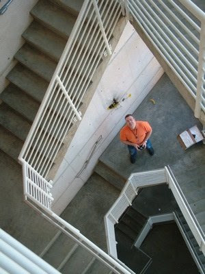
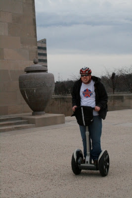

*Originally posted to [headrattle](https://headrattle.blogspot.com/2009/05/two-of-lifes-greatest-joys.html) on 2009-05-01.*

  
  
  
I think in their heart of hearts each parent hopes that their children will be like them. After all, they usually invest a great deal of energy throughout the child-rearing to "raise them up right" (that is, "right" as the parents interpret it). That only makes sense: if you're an idealist, say, you naturally hope your kids will have high ideals.  
  
But what the parenting manuals fail to mention is that the greatest blessing kids bring may not be the ways in which they resemble or emulate you, but in the ways they differ from (and may even challenge) you. Their interests, their life views, their choices, their knowledge--all these, and more, are often "beyond" you, that is, they are often beyond your understanding AND beyond your life experience. As they mature, this becomes increasingly evident. It seems ever more true, as Gibran writes of children:  
  
You may give them your love but not your thoughts,  
For they have their own thoughts.  
You may house their bodies but not their souls,  
For their souls dwell in the house of tomorrow,  
which you cannot visit, even in your dreams.  
You may strive to be like them, but seek not to make them like you.  
For life goes not backward nor tarries with yesterday.  
  
The poet likens this life process to archery, the parents being the bow and the children the arrows. It's an image that gives me great joy as I see my sons see and do things beyond my ken, but not beyond my love for them.
